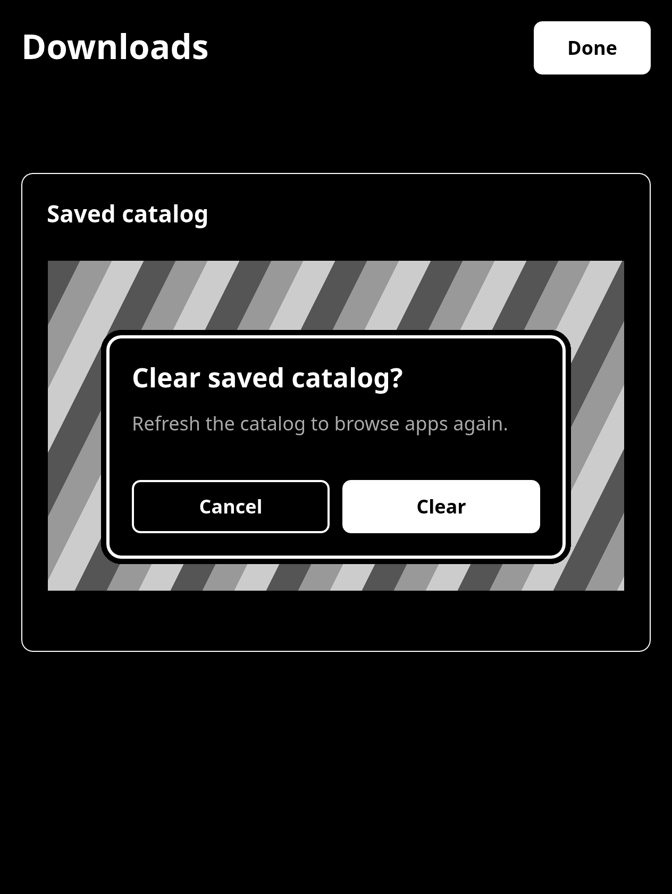

<div align="center">

# Hello

**A starting point for a native Primitive Kindle app.**

[**Install guide**](INSTALL.md) · [**Device notes**](docs/device-notes.md) · [**Changelog**](CHANGELOG.md)

</div>

---

Hello pairs a small saved counter with a desktop component gallery. Use it to see how native apps share Launcher’s drawing, keyboard, input, rotation, and sleep handling.

## Screenshots

<table>
<tr>
<td align="center"><br><sub>Run the native app example</sub></td>
<td align="center"><br><sub>Explore the shared controls</sub></td>
<td align="center"><br><sub>Inspect a modal sheet in dark mode</sub></td>
</tr>
</table>

<sub>Mac simulation captures at 1264 × 1680 pixels.</sub>

## Highlights

- **Shared component gallery.** See grouped rows, switches, tabs, page navigation, status, modal sheets, progress, keyboard, and messages.
- **Display modes.** Capture light, dark, and upside-down frames. The desktop preview checks that pressing a row changes only its own refresh rectangle.
- **Native lifecycle.** Exercise sleep, wake, exit, and the counter’s on-disk persistence.

## Quick start

1. Find the local ARMHF package and USB installation steps in the [install guide](INSTALL.md).
2. Extract the package, copy the `hello` and `documents` folders to your jailbroken Kindle’s user storage, and eject it.
3. Open Hello from Primitive Launcher. **Done** returns to the launcher grid.

## Develop locally

Keep `doannt-kindle-tools` and `doannt-kindle-launcher` beside this checkout, then run the following from this repo.

```sh
cargo test --offline --locked --workspace
cargo run --offline --locked -p hello-desktop
```

The desktop target writes previews to `build/previews/`. The desktop simulation verifies the saved counter and renders the component gallery. Physical Kindle testing is pending. See the [device notes](docs/device-notes.md) for the verification checklist.

## Use the template

- `hello-core` contains the app logic.
- `hello-render` draws the app and handles hit testing.
- `hello-kindle` provides the Kindle entry point.
- `hello-desktop` runs the host preview and component gallery.

The library script copies the executable to temporary storage. After building the Kindle executable, run
`scripts/stage.sh TARGET` and package the stage with `doannt-kindle-build/scripts/package.py`.

The `# PrimitiveUSBLease` library header lets a supported Launcher offer USB drive mode while the app is idle. Keep
permanent data in the app folder. Finish reads and writes inside `primitive_app::with_storage` and return owned data.
`primitive_app::save` already uses this protection. Use `App::storage_returned` to reload files edited from a computer.

Apps inherit Launcher’s display preferences. To override them, add a `settings.txt` file to the app’s folder on user
storage. Supported values are `dark_mode=on|off`, `auto_rotation=on|off`, and `rotation=upright|upside-down`.
When auto-rotation is off, the rotation setting fixes the orientation.

## Licence

Copyright (C) 2026 Doan Nguyen.

Code is licensed under [PolyForm Noncommercial 1.0.0](LICENSE). The original documentation and pictures are licensed under [CC BY-NC-SA 4.0](LICENSE-DOCS).
