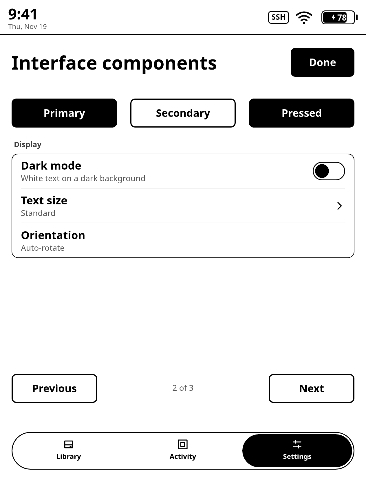

<div align="center">

# Hello

**A starting point for a native PrimitiveOS app.**

[**Install guide**](INSTALL.md) · [**Device notes**](docs/device-notes.md) · [**Changelog**](CHANGELOG.md)

</div>

---

Hello pairs a small saved counter with a desktop component gallery. Use it to see how native apps share Launcher’s
drawing, keyboard, input and rotation, and how they run under Primitive Launcher, which owns sleep, quick settings and
the theme while the app is open.

## Screenshots

<table>
<tr>
<td align="center"><br><sub>Run the native app example</sub></td>
<td align="center"><br><sub>Explore the shared controls</sub></td>
<td align="center"><br><sub>Inspect a modal sheet in dark mode</sub></td>
</tr>
</table>

<sub>Mac simulation captures at 1264 × 1680 pixels.</sub>

## Highlights

- **Shared component gallery.** See grouped rows, switches, tabs, page navigation, status, modal sheets, progress, keyboard, and messages.
- **Display modes.** Capture light, dark, and upside-down frames. The desktop preview checks that pressing a row changes only its own refresh rectangle.
- **Native lifecycle.** Exercise sleep, wake, the launcher’s redraw request, exit, and the counter’s on-disk persistence.

## Quick start

After setting up PrimitiveOS, open **Store** from Primitive Launcher. Choose **Hello** under **Apps**,
tap **Get**, and open it from the Launcher grid. The [install guide](INSTALL.md) also covers local USB testing.

## Develop locally

Keep `doannt-kindle-tools` and `doannt-kindle-launcher` beside this checkout, then run the following from this repo.

```sh
cargo test --offline --locked --workspace
cargo run --offline --locked -p hello-desktop
```

The desktop target writes previews to `build/previews/`. The desktop simulation verifies the saved counter and renders
the component gallery. On an ARMHF Kindle Oasis 3 running firmware 5.18.2, Hello opened from Launcher, incremented
its sample counter once, and returned to Launcher. See the [device notes](docs/device-notes.md) for the verification checklist.

## Use the template

- `hello-core` contains the app logic.
- `hello-render` draws the app and handles hit testing.
- `hello-kindle` provides the Kindle entry point.
- `hello-desktop` runs the host preview and component gallery.

The library script copies the executable to temporary storage. After building the Kindle executable, run
`scripts/stage.sh TARGET` and package the stage with `doannt-kindle-build/scripts/package.py`.

The `# PrimitiveUSBLease` library header lets a supported Launcher offer USB drive mode while the app is idle. Keep
permanent data in the app folder. Finish reads and writes inside `primitive_app::with_storage` and return owned data.
`primitive_app::save` already uses this protection. Use `App::storage_returned` to reload files edited from a computer.

Apps inherit Launcher’s display preferences. To override the rotation, add a `settings.txt` file to the app’s folder
on user storage. Supported values are `auto_rotation=on|off` and `rotation=upright|upside-down`. When auto-rotation is
off, the rotation setting fixes the orientation. The kit also reads `dark_mode=on|off` there, but under Primitive
Launcher an app follows the system theme: leave it out (see below).

## Run under Primitive Launcher

Primitive Launcher is the system layer over every app. While your app is open, the launcher keeps the power button,
sleep and wake, the lock screen, quick settings (the swipe down from the top edge), the power menu and the theme. The
rules are in the PrimitiveOS platform docs:
[contracts §1.1](https://github.com/PrimitiveOS/kindle-primitive/blob/main/docs/contracts.md#11-under-primitive-launcher-the-system-layer) and
[system architecture §4](https://github.com/PrimitiveOS/kindle-primitive/blob/main/docs/system-architecture.md#4-contracts-between-the-system-layer-and-apps).

The library entry, `deploy/Hello.sh`, declares the contract with two lines:

```sh
# Wake: redraw
[ "${PRIMITIVE_LAUNCHER:-0}" = 1 ] && trap '' USR1
```

`# Wake: redraw` must stay in the first ten lines of the entry, exactly as written. It tells the launcher that the app
draws its whole screen again when it gets `SIGUSR1`, so the launcher sends that signal when the screen must be drawn
again, for example after the user switched the theme in quick settings over the app. Without the line the app never
gets the signal, and it keeps the old theme until it starts again. The `trap` line makes the entry's own shell ignore
the signal, which goes to the whole process group; the app then sets its own handler.

`primitive_app::run` does the app’s part for you. Under the launcher (`PRIMITIVE_LAUNCHER=1`) it:

- turns `SIGUSR1` into one whole-screen redraw that reads the theme (`dark_mode` in the launcher’s `settings.txt`)
  again, before it handles anything that waited while the app was frozen;
- draws that redraw without a flash (`Display::show_calm`): the launcher has just flashed the screen for the theme
  switch, and a second flash would show the old theme for a moment;
- draws nothing on wake, because the launcher puts the app’s screen back after the sleep picture;
- drops the swipe down from the top edge, so it opens the launcher’s quick settings and never reaches `App::input` or
  `App::swipe`.

What not to do in your app:

- no sleep, lock screen or screensaver code of its own, and no changes to `preventScreenSaver` or the Kindle framework;
- no quick settings panel of its own, and no use of the swipe down from the top edge;
- no light or dark switch: keep `App::preferred_dark_mode` at `None` and leave `dark_mode` out of the app’s
  `settings.txt`;
- no full, flashing redraw of your own after the launcher’s request: return `Change::Full` and let the kit draw it.

The kit still saves the app’s data when the Kindle goes to sleep (`App::save`). Keep the two lines above if you rename
the entry. Remove `# Wake: redraw` only if your program stops using `primitive_app::run`: the signal ends a program
that does not handle it.

## Licence

Copyright (C) 2026 Doan Nguyen.

Code is licensed under [PolyForm Noncommercial 1.0.0](LICENSE). The original documentation and pictures are licensed under [CC BY-NC-SA 4.0](LICENSE-DOCS).
