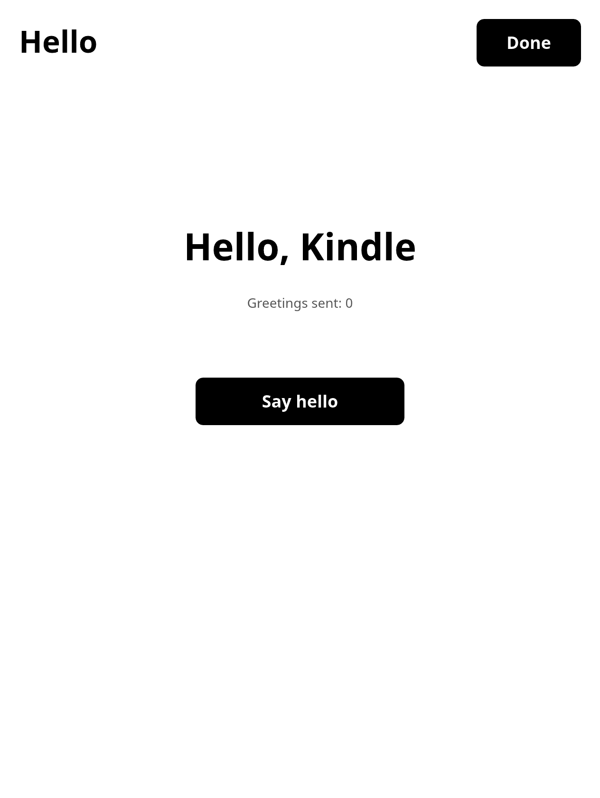

<div align="center">


# Hello

**A native Kindle example**

[](https://github.com/PrimitiveOS/kindle-primitive-app-template/actions/workflows/ci.yml)
[](https://github.com/PrimitiveOS/kindle-primitive-app-template/releases)
[](https://github.com/PrimitiveOS/kindle-primitive-app-template/tags)
[](LICENSE)
[](https://github.com/PrimitiveOS/kindle-primitive-app-template/stargazers)
[](https://primitiveos.github.io/kindle-primitive-catalog/v1/index.json)

[**Download**](https://github.com/PrimitiveOS/kindle-primitive-app-template/releases/latest) ·
[**Install guide**](INSTALL.md) ·
[**Changelog**](CHANGELOG.md)

</div>

---

A small sample app for building and testing native PrimitiveOS apps.

## Quick start

After setting up PrimitiveOS, open **Store** from Primitive Launcher. Choose **Hello** under **Apps**,
tap **Get**, and open it from the Launcher grid. The [install guide](INSTALL.md) also covers the standalone USB package.

## Screenshots

<table>
<tr>
<td align="center"><br><sub>Run the native app example</sub></td>
<td align="center"><br><sub>Explore the shared controls</sub></td>
<td align="center"><br><sub>Inspect a modal sheet in dark mode</sub></td>
</tr>
</table>

<sub>Mac simulation captures at 1264 × 1680 pixels.</sub>

## Highlights

- **Shared component gallery.** See grouped rows, switches, tabs, page navigation, status, modal sheets, progress, keyboard, and messages.
- **Display modes.** Capture light, dark, and upside-down frames. The desktop preview checks that pressing a row changes only its own refresh rectangle.
- **Native lifecycle.** Exercise sleep, wake, the launcher’s redraw request, exit, and the counter’s on-disk persistence.

## Build your own app

Start from this template, then read [docs/CONVENTIONS.md](docs/CONVENTIONS.md): the kit's `App` trait, the tap-feedback rule (every tappable control reverses black and white while it is held), dark mode and icons, tests, versions and the Store listing. `scripts/new-app.py` makes a new app folder from this template.

## Develop locally

Keep `doannt-kindle-tools` and `doannt-kindle-launcher` beside this checkout, then run the following from this repo.

```sh
cargo test --offline --locked --workspace
cargo run --offline --locked -p hello-desktop
```

The desktop target writes previews to `build/previews/`. The desktop simulation verifies the saved counter and renders
the component gallery. On an ARMHF Kindle Oasis 3 running firmware 5.18.2, Hello opened from Launcher, incremented
its sample counter once, and returned to Launcher. See the [device notes](docs/device-notes.md) for the verification checklist.

## Status

| Device | Status |
|---|---|
| Kindle Oasis 3 (1264 × 1680, firmware 5.18.2) | Not yet tested on hardware |

**Current version: 0.1.0.** Changes are in [CHANGELOG.md](CHANGELOG.md).

## Downloads

The badge at the top shows the number of Store downloads. It counts GitHub downloads of this app's release packages, across all versions and architectures, and is refreshed daily from the [Store catalog](https://primitiveos.github.io/kindle-primitive-catalog/v1/index.json).

## Documentation

[Install guide](INSTALL.md) · [Changelog](CHANGELOG.md) · [Device notes](docs/device-notes.md)

## Licence

Copyright (C) 2026 Doan Nguyen.

Code is licensed under [PolyForm Noncommercial 1.0.0](LICENSE). The original documentation and pictures are licensed under [CC BY-NC-SA 4.0](LICENSE-DOCS).
